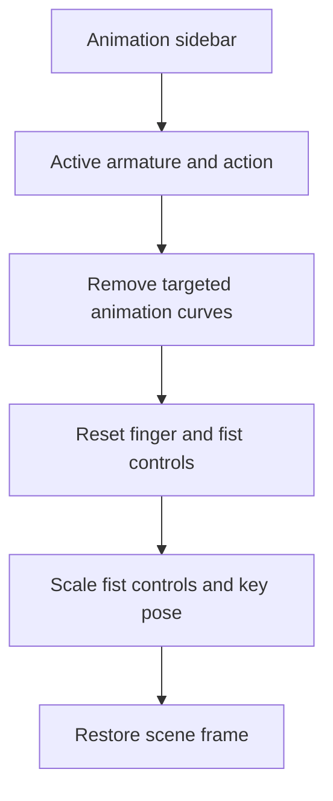

# Blender Tools

## Overview

A small Blender utility repository currently containing Fist Pose Cleaner. The add-on replaces finger animation in the selected armature’s active action with a static closed-fist pose, reducing repetitive hand-pose editing.

## My Contributions

The implementation provides an Animation sidebar panel and an operator that removes animation curves for named finger and fist controls on both hands, resets their transforms, and keys a replacement pose. It handles Euler, quaternion, and axis-angle rotations and reports missing bones.

## Architecture

## Technical Challenges

The operation traverses Blender’s layered action channel bags to remove targeted curves. It uses explicit bone names and scales the two fist controls to 0.5, relying on the rig’s existing behavior to close the hands.

## Results and Current State

One Python add-on is implemented, declaring Blender 5.0 as its minimum version. Each invocation processes one active action. No tests or example scenes are included; visual results and rig compatibility have not been independently verified.

## Development History

The two observed commits, both on September 23, 2026, introduce the add-on and a short README. These dates establish observed Git activity, not the project’s actual development period.
